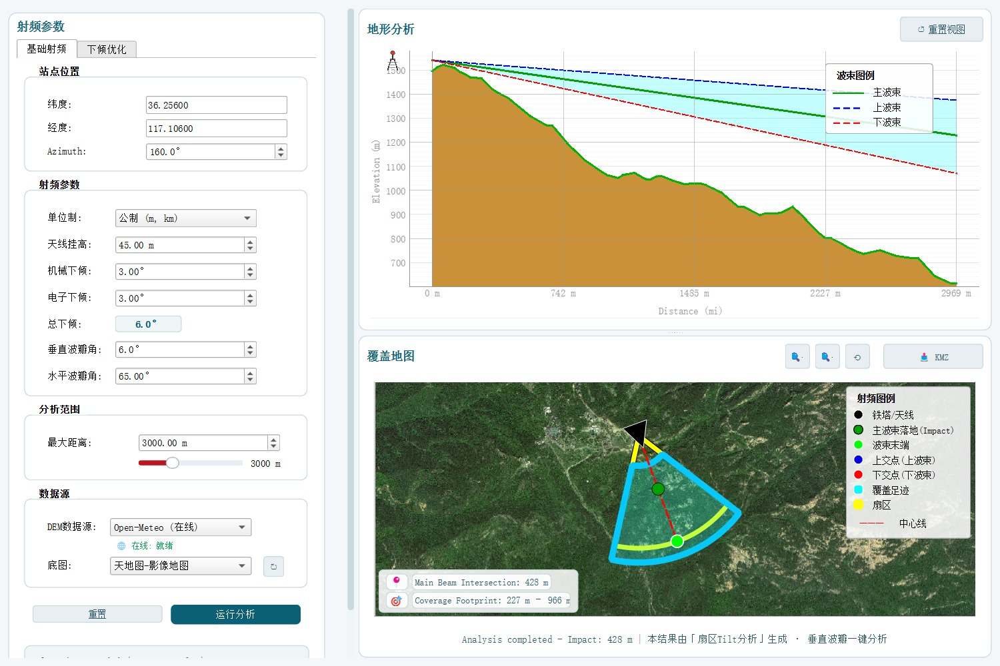

# 扇区一键 Tilt 分析（Sector Tilt Analysis）

点击地图任意扇区 / 工参 / 站点矢量要素，**一键**完成：

> 解析小区号(UniqueID) → 自动发现工参图层 → 提取 RF 参数（方位角 / 挂高 / 机械下倾 / 电子下倾）→ 弹出垂直波瓣分析对话框并自动填充 → **自动执行分析**（DEM 在线默认，Open-Meteo）。

## 效果图



上方为**地形剖面图**（含铁塔、主波束/上波束/下波束与地形剖面），下方为**覆盖地图**（扇区覆盖、覆盖足迹、主波束落点与上下交点）。

### 剖面图 · 山区看阻挡
- 内置**地形剖面图**：沿方位角方向剖出 0→2000m 的地形高程，叠加铁塔与主/上/下波束，**直观查看山体阻挡、遮挡角与余高**。
- 山区/丘陵场景无需再脑补地形，剖面上一眼看出主波束是否被山头吃掉、要不要调机械下倾。
- 地形数据**默认在线获取（Open-Meteo）**，无需本地 DEM；项目中仍须至少有一个栅格图层作占位。


## 依赖
- QGIS 3.16+（兼容 4.x）
- **无需安装任何其他插件**：垂直波瓣分析引擎已内嵌于 `vendor/`，开箱即用。
- 当前 QGIS 项目中**至少一个栅格图层**（DEM 或底图；在线 DEM 也需要一个栅格层占位）。

## 安装
把整个 `sector_tiltm_auto/` 文件夹复制到 QGIS 用户插件目录：

```
C:\Users\<用户名>\AppData\Roaming\QGIS\QGIS3\profiles\default\python\plugins\sector_tiltm_auto\
```

重启 QGIS → 插件管理器中勾选启用 → 工具栏出现「扇区一键Tilt分析」按钮。

## 用法
1. 打开含扇区/工参的 QGIS 项目（已加载经纬度、方位角、倾角等字段的矢量层 + 一个栅格层）。
2. 点击工具栏「扇区一键Tilt分析」按钮（可勾选，进入点选模式）。
3. 在地图上点击一个小区要素 → 自动弹出垂直波瓣分析对话框并跑出结果（剖面 + 下倾建议）。
4. 可继续点下一个小区；再点一次按钮退出点选模式。

## 可选配置（QGIS 项目变量）
- `@gongcan_layer`：指定工参图层名（有多张候选时跳过选择框）
- `@basemap_keyword`：底图模糊匹配关键词（默认 `sanwei`）
- `@coverage_layer`：覆盖图层名（预留，RSRP 统计用）

## 实现说明
- 字段自动映射：中英文 + 模糊匹配（华为/中兴/爱立信导出字段差异自动适配），小区号自动识别 UniqueID / 小区号 / 小区ID / gNodeBID-CellID 等字段，无需手动配置。
- 完全独立：弹窗、分析引擎、地图控件全部内嵌，不再引用任何外部插件，分享给同事即拷即用。
- 界面全中文化：参数面板、图例、按钮、提示均为中文。
- 与你的邻区核查 action 互不干扰，独立插件。

## English

**Sector One-Click Tilt Analysis** — click any sector / engineering-parameter / site vector feature on the map, and the plugin automatically parses the cell UniqueID, discovers the engineering-parameter layer, extracts azimuth / height / mechanical & electrical tilt, fills them into the vertical beam analysis dialog and **auto-runs the analysis** (online DEM by default, Open-Meteo). It outputs a tilt suggestion and a coverage profile, including a built-in **terrain profile** (tower + main/upper/lower beams vs terrain elevation) to visualize mountain blocking and shielding angles.

- Requires QGIS 3.16+ (compatible with 4.x)
- No external plugin needed: the vertical beam analysis engine is embedded in `vendor/`
- At least one raster layer (DEM or basemap) is required in the project
- License: GPLv3 (engine derived from TiltMaster by Achmad Amrulloh)

## 作者
陈建雨 · 569330236@qq.com

## 许可
本插件基于 GPLv3 许可开源，分析引擎部分由原作者（Achmad Amrulloh）的 TiltMaster 插件派生，相关源文件头部保留原许可与版权声明。

## 上架状态
准备上架 QGIS 官方插件库（plugins.qgis.org）。源码仓库：https://github.com/hebaujianyu/sector-tilt-analysis

