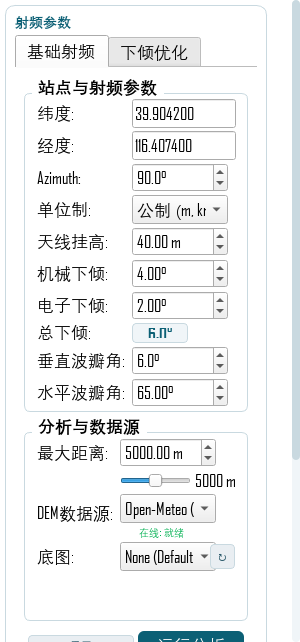
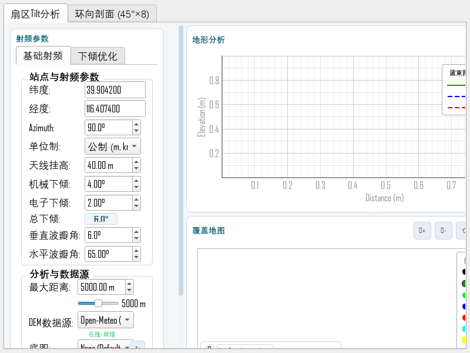
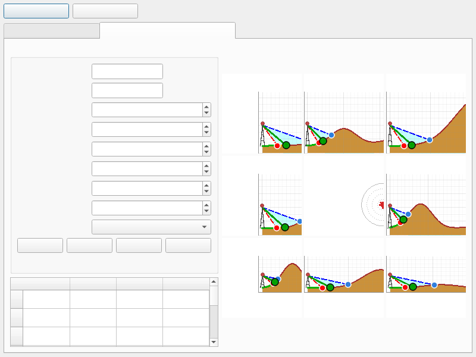

# 扇区Tilt分析工具箱 — 使用说明

> QGIS 插件 · 扇区垂直波瓣（Tilt）分析 + 环向阻挡剖面（45°×8）
> 版本：v0.4.15　|　适用：QGIS 3.34 及以上（Windows）

---

## 一、插件能做什么

| 功能 | 说明 |
|---|---|
| **点选传参出图** | 在地图上点一下扇区/工参要素，自动解析小区号（CGI → 基站号+小区号 → 小区号），从工参图层反查 RF 参数，自动填入并运行垂直波瓣分析 |
| **手动参数分析** | 直接输入经纬度、挂高、机械/电子下倾、波束宽度，生成垂直波瓣剖面（地形 + 主/上/下波束 + 遮挡点） |
| **环向剖面 (45°×8)** | 以一点为中心，8 个方向各生成一条独立地形剖面 + 中心阻挡玫瑰图，一眼看出哪个方向有山体遮挡 |
| **下倾优化**（进阶） | 按最大覆盖 / 目标距离 / 均匀覆盖自动搜索最优总下倾 |

所有数据**本地处理**，仅 DEM 高程默认走 Open-Meteo 在线接口（可切换本地 DEM 离线使用）。

---

## 二、安装

### 方式 1：从 ZIP 安装（推荐）

1. 打开 QGIS → 菜单栏 **插件 → 管理并安装插件**
2. 左侧选 **从 ZIP 安装** → 选择 `sector_tiltm_auto-0.4.15.zip` → **安装插件**
3. 安装完成后**重启 QGIS**

### 方式 2：手动解压

1. 把 zip 解压，得到文件夹 `sector_tiltm_auto`
2. 复制到 QGIS 插件目录：
   ```
   %APPDATA%\QGIS\QGIS3\profiles\default\python\plugins\
   ```
   （整条路径通常是
   `C:\Users\<用户名>\AppData\Roaming\QGIS\QGIS3\profiles\default\python\plugins\sector_tiltm_auto`）
3. 重启 QGIS → **插件 → 管理并安装插件 → 已安装** → 勾选 **Sector TiltM Auto**

### 环境要求

- QGIS 3.34+（自带 Python 即可，无需额外安装）
- 建议加载一个**底图**（如 OSM/天地图）和一个**扇区/工参矢量图层**（GPKG/Shapefile 均可）

---

## 三、使用步骤

### 3.1 点选传参（最常用，一键出图）

1. 在图层面板中**打开**扇区/工参图层（图层必须处于可见状态）
2. 点击工具栏上的插件图标「**扇区点选分析**」（唯一图标，可勾选）
3. 在地图上**单击任意扇区要素**：
   - 自动解析小区号 → 查工参 → 带入经纬度/挂高/下倾/波束宽度
   - 自动弹出工具箱窗口并运行分析，直接出垂直波瓣剖面
4. 再点别处可连续分析；点空地只会在状态栏提示，不会报错
5. 分析完把图标取消勾选即恢复普通地图操作

> 工参图层支持三种小区号写法：CGI（如 `46000-3286202-202`）、基站号+小区号
> 分字段（`gNodeBID`/`基站号` + `CellID`/`小区号`）、组合字段（`UniqueID`/`Cnum`）。
> 字段名中英文均可（经度/longitude、挂高/height 等）。

### 3.2 手动参数分析

1. 菜单栏 **插件 → 扇区Tilt分析 → 扇区Tilt分析工具箱…**
2. 在左侧「站点与射频参数」填入：
   - **纬度 / 经度**（WGS84 十进制度）
   - **Azimuth** 方位角（°）
   - **天线挂高**（m）、**机械下倾 / 电子下倾**（°，总下倾自动求和）
   - **垂直/水平波瓣角**（°）
3. 「分析与数据源」里设定**最大距离**（默认 2000 m）
4. 点 **运行分析** → 右侧出垂直波瓣剖面图

### 3.3 环向剖面（45°×8 阻挡分析）

1. 菜单栏 **插件 → 扇区Tilt分析 → 环向剖面分析 (45°×8)…**
2. 取点（二选一）：
   - 点 **在地图上点选取点**，再到地图上单击（点到要素会顺带带入 RF 参数，点到空地只取经纬度）
   - 或直接输入经纬度 + 挂高/下倾/波束宽度
3. 点 **生成环向剖面** → 右侧九宫格：8 个方向独立剖面（按罗盘方位排列）+ 中心阻挡玫瑰图
4. 左侧表格汇总每个方向的首次遮挡距离与结论

### 3.4 参数速查

| 参数 | 含义 | 典型值 |
|---|---|---|
| 纬度/经度 | 站点位置（WGS84） | 39.904200 / 116.407400 |
| Azimuth | 天线方位角 | 0~359.99° |
| 天线挂高 | 天线离地面高度 | 20~45 m |
| 机械下倾 | 天线下倾（机械） | 0~8° |
| 电子下倾 | 天线下倾（电子，Ret） | 0~6° |
| 垂直波瓣角 | 垂直半功率角 | 6~10° |
| 最大距离 | 剖面分析半径 | 1000~2000 m |
| DEM数据源 | 在线 Open-Meteo / 本地 DEM | 无本地 DEM 用在线 |

---

## 四、效果展现

### Tab1 紧凑参数区（v0.4.15：4 分组框合并为 2 个，宽 390→272px，一屏看完无需滚动）



### Tab1 完整窗口（左参数 / 右垂直波瓣剖面）



### Tab2 环向剖面九宫格（8 方向剖面 + 中心阻挡玫瑰图）



剖面图元素说明：

- **赭黄实心区**：地形；脊线按主波束净空自动分色（绿=净空>10m，橙=0~10m，红=被遮挡）
- **绿色实线**：主波束中心线（止于触地点）；**蓝/红虚线**：波束上/下边缘
- **浅青色三角**：波束覆盖范围
- **圆点**：绿色=主波束落地点，蓝/红=上下波束首触点；红字标注首次遮挡距离
- **中心玫瑰图**：8 方向遮挡距离极坐标图，越长=该方向越畅通

---

## 五、常见问题

| 现象 | 原因与处理 |
|---|---|
| 点选后提示"未找到矢量要素" | 点在了空地或目标图层未勾选可见。请点在扇区/工参要素上，并确认图层树中该图层可见 |
| 提示"未找到工参图层" | 工程里没有带经纬度字段的矢量图层。请加载工参表；或通过 项目属性 → 变量 设置 `@gongcan_layer` 指定 |
| 某参数显示"未识别" | 该字段名不在候选清单。把实际字段名反馈给维护者补充，或手填 |
| DEM 在线失败 | 自动降级；离线环境请在工程加载 DEM 栅格并切换「本地DEM (离线)」 |
| 分析弹英文报错 | v0.4.13 起已修复（无 DEM 自动生成锚点）。若仍出现请升级到最新版 |
